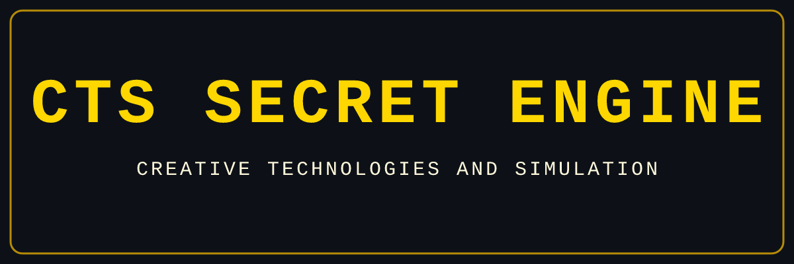

<p align="center">
  
</p>

<h1 align="center">CTS Secret Engine [CTS]</h1>
<p align="center">
  <b>Creative Technologies and Simulation — Hệ thống AI Tự hành, Mô phỏng & Kỹ thuật Sáng tạo Đa nền tảng</b>
</p>

<p align="center">
  <a href="README.md"></a>
  <a href="https://github.com/xuannamservice-ui/CTS-Secret-Engine/blob/main/LICENSE"></a>
  <a href="https://github.com/xuannamservice-ui/CTS-Secret-Engine"></a>
</p>

---

## 1. Giới thiệu tổng quan

**CTS Secret Engine** là hệ thống AI tự hành (Autonomous AI Agent) được phát triển bởi **Creative Technologies and Simulation (CTS)**. Hệ thống được thiết kế để trở thành một kỹ sư AI, chuyên gia mô phỏng và trợ lý nghiên cứu toàn diện với vòng lặp tự học khép kín:

- **Tự động đúc kết Kỹ năng (Procedural Skills):** Tự tạo mới và hoàn thiện kỹ năng từ kinh nghiệm giải quyết bài toán thực tế.
- **Chuẩn Viết Học thuật, Nghiên cứu Khoa học & Chống Văn phong AI (`MASTER PROMPT v5.4.1`):** Tích hợp mặc định bộ quy chuẩn 79 quy tắc **MASTER PROMPT v5.4.1**, bộ công cụ **Avoid AI Writing** (`conorbronsdon/avoid-ai-writing`), công cụ **xóa dấu vết Markdown của Claude** (`claude-markdown-cleaner`) và xuất tài liệu Word (`.docx`) chuẩn **Nghị định 30/2020/NĐ-CP** (A4 dọc, Times New Roman 13pt, căn đều, giãn dòng 1,3).
- **Bộ nhớ liên phiên (Cross-Session Memory):** Ghi nhớ kiến trúc dự án, phong cách làm việc của người dùng và tìm kiếm toàn văn (FTS5) trên lịch sử hội thoại.
- **Đa diện mạo giao tiếp:** Hoạt động đồng bộ trên **CTS CLI** (`cts`), **CTS Terminal UI** (`cts --tui`), **CTS Web Dashboard** (`cts web`), **CTS Desktop App** và **CTS Messaging Gateway** (`cts gateway`).

---

## 2. Cài đặt & Khởi chạy

```bash
git clone https://github.com/xuannamservice-ui/CTS-Secret-Engine.git
cd CTS-Secret-Engine
bash scripts/install.sh --dir "$(pwd)"
```

Sau khi cài đặt hoàn tất, các lệnh `cts`, `cts-engine` và `cts-secret-engine` sẽ sẵn sàng trong `~/.local/bin`:

```bash
cts                        # Bắt đầu trò chuyện tương tác trên CLI
cts --tui                  # Mở giao diện Terminal UI hiện đại
cts setup                  # Chạy trình cài đặt cấu hình CTS Secret Engine
cts model                  # Chọn nhà cung cấp AI và mô hình mặc định
cts web                    # Mở giao diện Web Dashboard tại http://127.0.0.1:9119
cts --help                 # Xem hướng dẫn chi tiết toàn bộ các lệnh
```

---

## 3. Bảng tham chiếu lệnh CTS CLI (`cts`)

| Lệnh | Chức năng |
| :--- | :--- |
| `cts` / `cts chat` | Mở phiên làm việc tương tác với CTS Secret Engine |
| `cts chat -q "<câu hỏi>"` | Thực thi truy vấn một lần (One-shot) và xuất kết quả |
| `cts --tui` | Khởi chạy giao diện toàn màn hình CTS TUI |
| `cts setup` | Trình hướng dẫn cấu hình toàn diện (Model, Tools, Gateway, TTS...) |
| `cts model` | Chọn nhanh Provider (OpenAI, Anthropic, OpenRouter, Custom...) và Model |
| `cts tools` | Bật/tắt các bộ công cụ theo từng nền tảng |
| `cts skills list` | Liệt kê toàn bộ 59 kỹ năng tích hợp sẵn (bao gồm `cts-simulation-architect`) |
| `cts gateway` | Quản lý dịch vụ kết nối Telegram, Discord, Slack, Teams, Google Chat, WhatsApp |
| `cts web` / `cts dashboard` | Khởi chạy bảng điều khiển Web trực quan |
| `cts sessions browse` | Duyệt và khôi phục các phiên làm việc cũ |
| `cts doctor` | Kiểm tra và chẩn đoán toàn bộ môi trường hoạt động |
| `cts update` | Cập nhật hệ thống từ kho lưu trữ `xuannamservice-ui/CTS-Secret-Engine` |

